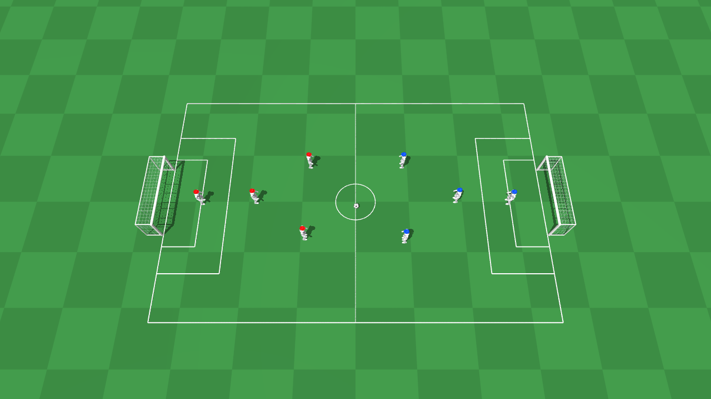

# Q1 Robot Soccer — MAPPO 4v4

Q1 V3 的 4v4 足球训练项目。红蓝各四台机器人，每台保留 22 个关节、独立自由基座和对应颜色帽子。使用 **MuJoCo Warp GPU 批量物理 + 八机共享 MAPPO + 队伍身份与角色编码网络**，包含 28 阶段课程、晋级门控、模型续训、GUI 回放和 W&B 看板。



本分支 `MAPPO4V4` 的项目位于仓库根目录。`main` / `PPO` / `SuperMimic` 为其他实现。代码已完成物理、课程和训练闭环验证；不包含训练权重，尚未验证完整足球策略收敛。

## 安装

```bash
git clone --branch MAPPO4V4 git@github.com:MohismLab/Q1-Robot-Soccer.git
cd Q1-Robot-Soccer
conda env create -f environment.yml
conda activate q1-kick-4v4
```

Python 3.11、PyTorch 2.9.0/CUDA 12.8、MuJoCo/MuJoCo Warp 3.17.0、Warp 1.18.0；详细版本见 `requirements.txt`。GPU 训练需要兼容的 NVIDIA GPU/驱动，首次运行会编译物理内核。`third_party/mappo` 已包含固定版本源码，安装不需要再次克隆或获取 submodule。

`./scripts/python.sh` 优先使用 `Q1_4V4_PYTHON` 显式指定的解释器；否则优先寻找 `q1-kick-4v4` 环境，即使当前激活的是 `q1-kick`。找不到项目环境时才回退当前 Conda/Python，并清除桌面 AppImage 可能注入的 Python/动态库路径。

## 训练与续训

先跑有限的离线检查：

```bash
./scripts/python.sh train.py --backend warp --num-envs 4 --horizon 8 \
  --iterations 1 --epochs 1 --no-wandb --output logs/smoke
```

正式训练示例：

```bash
./scripts/python.sh train.py --backend warp --device cuda:0 \
  --num-envs 1024 --horizon 128 --epochs 5 --iterations 20000 \
  --nconmax 1536 --njmax 6144 --learning-rate 0.0001 \
  --save-interval 1 --output logs/train --run-name q1-mappo-4v4
```

`--policy-sharing shared` 为默认设置：红蓝八台共用一套 actor、critic、Adam 优化器和 ValueNorm，红蓝样本混合后统一计算优势并进行 PPO 更新。队伍归属以已知的红/蓝 one-hot 显式输入；保留原有机器人自身坐标，critic 仍按本队在前、对手在后组织状态。角色输入区分四种职责。红蓝回报和晋级统计分别保留，优化器诊断集中在 `debug/shared_*`。共享 actor 输入为130维，critic为1030维；物理环境原始观测仍为128维。

`--num-envs` 为并行球场数，每场八台机器人。先按可用硬件验证小规模，再增加并行数；更大批次不保证更高吞吐。当前物理、PD、观测、奖励、重置、GAE 和学习均在 GPU；中央 critic 输入按 minibatch 重建，减少全局状态副本。接触/约束容量默认每场 `--nconmax 768 --njmax 3072`，各物理子步锁存溢出与非有限状态，异常会阻止更新。

```bash
./scripts/python.sh train.py --checkpoint logs/train/last.pt \
  --num-envs 1024 --iterations 1000 --output logs/resumed
```

`--iterations` 是本次额外更新数。保存策略网络、优化器、ValueNorm、课程、迭代与随机状态，仿真世界重新初始化。SIGINT/SIGTERM 在当前迭代完成后保存退出。checkpoint 用 `policy_sharing` 标明布局，共享模式只保存一份策略状态；旧的两队独立 checkpoint 自动按独立布局恢复，显式要求跨布局续训会报错。共享模式从头训练应省略 `--checkpoint`，使用新 W&B run，从课程0 `balance` 开始。旧检查点保留权重、优化器和全局迭代；新增相位和速度指令使actor观测由121扩至128维，critic由972扩至1028维，输入权重和优化器矩按字段迁移，新列初始化为零。奖励变更时重置ValueNorm。通过 `--start-course 2` 可从新课程2重新认证；未指定时按检查点课程恢复或按迁移规则重新认证。

多 GPU 同步训练使用独立入口，各卡共同更新同一套八机共享策略：

```bash
CUDA_VISIBLE_DEVICES=0,1,2,3,4 ./scripts/python.sh -m torch.distributed.run \
  --standalone --nproc_per_node=5 train_distributed.py \
  --num-envs 4096 --horizon 128 --epochs 5 --iterations 20000 \
  --checkpoint logs/train/last.pt --nconmax 1536 --njmax 6144 \
  --learning-rate 0.0001 --save-interval 1 --output logs/distributed
```

多卡入口的 `--num-envs` 是**每卡球场数**，上例共 20,480 场、163,840 台机器人；4096 场适用于已验证的 96GB 显卡，其他硬件应先测显存和吞吐。每卡共享 PPO 的 minibatch 数是单队设置的两倍，保持单次显存开销接近原规模。每个进程只访问分配给它的 GPU，梯度先跨卡平均再裁剪，优势和 ValueNorm 使用全体样本统计。结束回合跨卡交错汇总，所有卡使用相同的课程门控；只有主进程写 checkpoint、TensorBoard 和 W&B。checkpoint 保存每卡随机状态，并检查各卡策略参数完全一致；扩展单卡权重时自动为其他卡分配不同随机种子。W&B 的性能组包含全局吞吐、GPU 数量、并行球场总数、各卡和总显存；通过 `WANDB_RUN_ID` 和 `WANDB_RESUME=must` 可衔接原 run。

## 课程

课程0单独通过后，可从刚保存的共享策略checkpoint切换到并行课程：

```bash
CUDA_VISIBLE_DEVICES=0,1,2,3,4 ./scripts/python.sh -m torch.distributed.run \
  --standalone --nproc_per_node=5 train_distributed.py --curriculum-mode parallel \
  --checkpoint logs/train/last.pt --num-envs 4096 --horizon 128 --epochs 5 \
  --nconmax 1536 --njmax 6144 --learning-rate 0.0001 --output logs/parallel
```

主训练80%、复习10%、下一层探索10%，前置关系、整数分配及独立门控见 `CURRICULUM.md`。现有actor/critic输入尺寸不变，恢复权重和优化器，不从头训练。串行课程0未通过的checkpoint会被拒绝切换；后续并行checkpoint默认按并行模式恢复。

28 阶段按重心转移、交替踏步、低速步行、全向移动、启停、足球技能和逐级对抗组织。完整清单见 CURRICULUM.md。

红蓝分别要求稳定率≥90%和各自任务成功率。每阶段至少更新 32 次，每 16 次检查一次；每个独立窗口至少 512 个已结束回合，红蓝各至少 256 个，分别满足稳定率和任务成功率后，连续通过三个窗口才晋级。基础运动阶段各机器人独立重置，足球阶段按参与者的整场回合重置。

[CURRICULUM.md](CURRICULUM.md) 列出具体出生、成功标准、阈值、迁移和指标说明。仅脚部真实接触计入技能触球，左右脚分别统计；正踢/侧踢依据脚运动与球推进分摊，斜踢、双脚接触不重复领取完整奖励。当前未包含倒地自主起身、专门的带球急转或手部扑救。

## GUI / 回放

```bash
./scripts/python.sh play.py --list-courses
./scripts/python.sh play.py --course turn --checkpoint logs/train/last.pt
./scripts/python.sh play.py --course 12 --checkpoint logs/train/last.pt
./scripts/python.sh play.py --course side_right --neutral
```

`--course` 接受名称或编号 0–27，`--stage` 是别名。GUI 默认运行到关闭窗口；`--speed 0.5` 半速，`--steps 1000` 限制控制步数。当前课程用一个 GPU 物理球场回放，通过原生 MuJoCo 显示状态。

省略权重时，若存在 `logs/active_training.json` 则自动查找其中的 `last.pt`，否则使用中立 PD。通过命令行直接运行训练时不会自动创建该本机运行索引，可显式传入 `--checkpoint`。指定课程只切换任务，不代表策略已掌握对应技能。新权重需重启 GUI 加载。

```bash
./scripts/python.sh play.py --course turn --checkpoint logs/train/last.pt --headless --steps 50
./scripts/python.sh play.py --neutral --image artifacts/scene.png
```

## W&B

默认项目 `mohismlab-robotics/q1-humanoid-kick-4v4`。先执行 `wandb login`，或通过环境变量配置凭据；密钥不放入项目文件。`--no-wandb` 可关闭云端记录。

指标分为 **01 总览、02 晋级、03 技能、04 性能、05 步态质量**，红蓝回报、左右脚触球、正踢/侧踢分别成组对比，`debug/*` 默认隐藏。每轮同时写 TensorBoard、`metrics.jsonl` 和 checkpoint。

```bash
./scripts/python.sh scripts/create_dashboard.py
```

创建保存视图需要 `logs/active_training.json`，其 `output` 字段指向训练输出目录，`run_name` 可选。该目录下的 `wandb_run.json` 由训练入口生成。脚本输出看板链接并保存到 `artifacts/dashboard.json`。

## 验证

```bash
./scripts/python.sh -m pytest -q tests
Q1_TEST_WARP=1 ./scripts/python.sh -m pytest -q tests
```

第二条显式开启 GPU 物理验证。当前版本已通过 67 项 CPU/GPU 检查，覆盖完整课程、真实触球、机器人碰撞、独立重置、进球、超时、门控、归一化和权重恢复。GUI 已做启动/退出短测；部分驱动可能输出 OpenGL 提示。

`scripts/smoke.py` 与 `scripts/smoke_warp.py` 保留早期的验证流程，验证当前课程应使用上面的 `tests` 命令。

## 来源与限制

- 原 Q1 资源、PD 来自 `q1-humanoid-kick`；机器人资源来源、哈希见 `SOURCE.json` 与 `resources/q1_description/SOURCE.json`。
- 官方 [MAPPO](https://github.com/marlbenchmark/on-policy) 源码提交为 `de66d7a4b23fac2513f56f96f73b3f5cb96695ac`，保留于 `third_party/mappo`，许可证随源码提供。
- 策略使用理想位置跟踪观测，当前未加入原单人项目的视觉噪声。角色固定为守门员、后卫、前锋、支援；无动态角色分配。
- 训练日志、模型、Conda 环境、服务器配置和认证资料不随仓库发布。GPU 规模与课程收敛需在目标硬件上分别验证，不能直接用于真机控制。


从指定课程重新认证并续训（编号以 CURRICULUM.md 为准）：

```bash
./scripts/python.sh train.py --checkpoint logs/train/last.pt --start-course 2 \
  --num-envs 1024 --horizon 128 --epochs 5 --learning-rate 0.0001 \
  --nconmax 1536 --njmax 6144 --iterations 20000 --save-interval 1 --output logs/gait
```

`--start-course` 仅重置课程和晋级统计，不重置全局训练轮次。新观测迁移和奖励统计重置自动按checkpoint元数据执行；同结构继续训练不会再次重置。当前步态新增的近似KL与裁剪比例位于debug组，可在看板性能分组查看。物理失败保存 `physics_failure.json`，包含跨重置保留的具体异常位，不会覆盖最近有效checkpoint。
