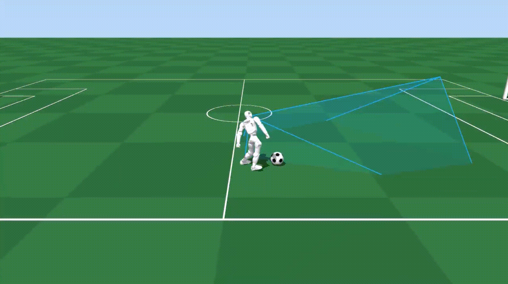
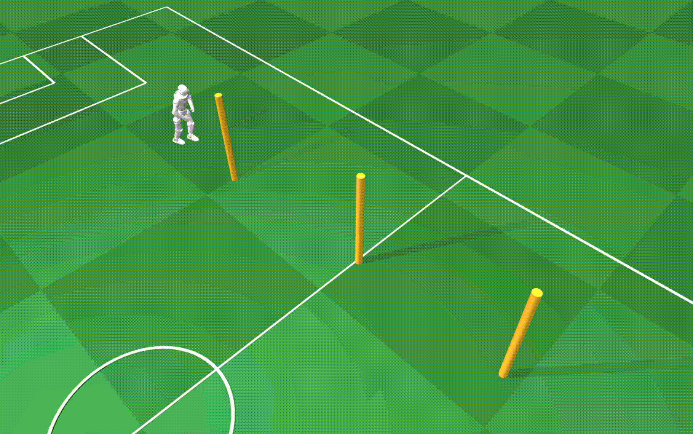

# Q1 Robot Soccer

[English](README.md) | 简体中文

**围绕人形机器人运动控制、踢球与团队足球对抗的仿真和学习项目。**

Q1 Robot Soccer 基于启元 Q1 人形机器人，围绕踢球和S 型绕杆，探索从人形机器人运动控制算法实现。

项目整合仿真环境、训练配置、策略回放与评估工具，为机器人控制、模仿学习和强化学习开发提供可修改的实验基础。你可以从现有任务开始复现实验，也可以调整观测、奖励、策略网络和训练流程，探索新的机器人行为。




*Q1 人形机器人 踢球和S 型绕杆。各任务的动态演示见下方课程入口。*

[核心特性](#核心特性) · [任务与演示](#任务与演示) · [快速开始](#快速开始) · [环境与资源要求](#环境与资源要求) · [项目结构](#项目结构) · [开发与扩展](#开发与扩展)

## 核心特性

- **多类机器人任务**：覆盖踢球与连续绕杆，为运动控制和策略提供不同的实验入口。
- **多种学习路线**：包含专家轨迹采集、模仿学习、基于世界模型的策略训练与分阶段强化学习，可按研究方向选择任务。
- **训练、回放与评估工具**：各任务提供对应配置和运行入口，支持检查训练管线、加载策略并记录实验结果。
- **共享仿真与机器人资源**：复用 MuJoCo 环境、机器人模型及公共训练代码，通过可编辑安装直接开展源码开发。

## 任务与演示

| 任务 | 任务目标 | 算法与实践内容 |
| --- | --- | --- |
| [踢球](courses/football-kicking/README.zh-CN.md) | 根据信息接近并踢球 | 专家轨迹采集、模仿学习与在线策略更新 |
| [S 型绕杆](courses/pole-weaving/README.zh-CN.md) | 沿三杆路线连续绕行 | SuperMimic 世界模型、观测设计与奖励设计 |

两个任务均有独立的配置、训练流程与资源要求。点击任务名称可查看演示 GIF、首次体验步骤及完整运行说明。

课程覆盖范围描述的是训练任务设计；实际策略能力需结合 checkpoint 和评估结果判断。

## 快速开始

### 1. 安装基础环境

准备 Linux、Conda 或 Mamba，并在仓库根目录执行：

```bash
# 初始化第三方子模块
git submodule update --init --recursive

# 创建并激活 Python 3.11 环境
conda env create -f environment.yml
conda activate q1-kick-4v4

# 以可编辑模式安装项目包
python -m pip install --no-deps -e .
```

依赖下载、CUDA 要求和安装检查见[环境搭建指南](docs/setup.md)。

### 2. 选择任务并准备资源


- **关注与模仿学习**：进入[足球踢球](courses/football-kicking/README.zh-CN.md)，先准备专家 checkpoint，再采集短程轨迹或使用正式数据集。
- **关注世界模型与运动控制**：进入 [S 型绕杆](courses/pole-weaving/README.zh-CN.md)，按说明准备任务专用 warmup checkpoint。

### 3. 按课程页开始体验

请按所选课程页中的首次运行说明准备资源，并查看对应的训练、回放与评估命令。课程 README 提供中英文版本；所链接的环境搭建等详细指南目前仍以中文为主。

##  环境与资源要求

统一基础环境使用 **Linux、Python 3.11、MuJoCo 和 PyTorch**。当前依赖采用 CUDA 12.8 版 PyTorch；GPU 流程需要可用的 NVIDIA GPU 和兼容驱动。

| 任务 | CPU 与 GPU 使用范围 | 额外模型或数据 |
| --- | --- | --- |
| 足球踢球 | CPU 可运行冒烟训练；正式训练使用 CUDA | 冒烟流程需要专家 checkpoint；正式训练还需完整成功轨迹数据集 |
| S 型绕杆 | 训练默认使用 NVIDIA GPU；评估与演示默认使用 CPU | 训练需要任务 7.7 专用 warmup checkpoint；模型文件需另行获取 |


课程训练所需的专用权重和数据不一定随 Git 仓库分发，请在运行前阅读对应课程的资源说明。S 型绕杆的资产登记与复现细节见[资产与复现说明](docs/pole-weaving.md)。

## 项目结构

```text
Q1-Robot-Soccer/
├── courses/                 # 任务配置、课程实现与运行入口
│   ├── football-kicking/    # 踢球配置与任务说明
│   ├── pole-weaving/        # S 型绕杆环境、训练与评估
│   └── soccer-4v4/          # 4v4 仿真、训练与比赛逻辑
├── shared/                  # 跨任务共用的代码与资源
│   ├── q1-mujoco/           # MuJoCo 环境、机器人模型与工具
│   └── supermimic/          # 共享训练代码、策略与专家工具
├── 3rdparty/                # 第三方依赖
├── docs/                    # 安装、复现、维护与演示资源
├── environment.yml          # Conda 环境定义
└── requirements.txt         # Python 依赖
```

Python 包通过根目录的 `setup.py` 映射到课程与共享源码位置。可编辑安装后，修改源码即可用于后续运行；文件归属及规范命令见[维护清单](docs/maintenance/course-file-inventory.md)。

## 开发与扩展

可以按实验目标从以下位置开始：

- **调整任务与奖励**：在对应任务实现中修改观测、奖励、重置和终止条件，并使用一致的评估配置比较行为变化。
- **改进策略与训练**：从课程配置及对应训练代码入手，调整网络、学习参数或课程调度，保留 checkpoint 和实验配置以便复现。
- **扩展仿真与机器人资源**：在 `shared/q1-mujoco/` 中查找公共环境与模型，在课程目录中维护任务专属逻辑。

足球踢球使用的 `q1_soccer` 训练包位于 `shared/supermimic/`；任务专属实现位于各自课程目录。完整模块映射见[维护清单](docs/maintenance/course-file-inventory.md)。训练数据、checkpoint 和运行日志保存在本地 `logs/` 或课程指定目录，不纳入 Git。

## 相关项目

项目使用 MuJoCo、PyTorch 和 Warp 等仿真与训练组件，并集成 [SuperMimic](3rdparty/SuperMimic/README.md) 相关代码。各组件的来源、使用方式与许可请参阅对应目录中的说明。

## 许可证

项目许可证见 [LICENSE](LICENSE)。第三方组件保留各自的许可证。
