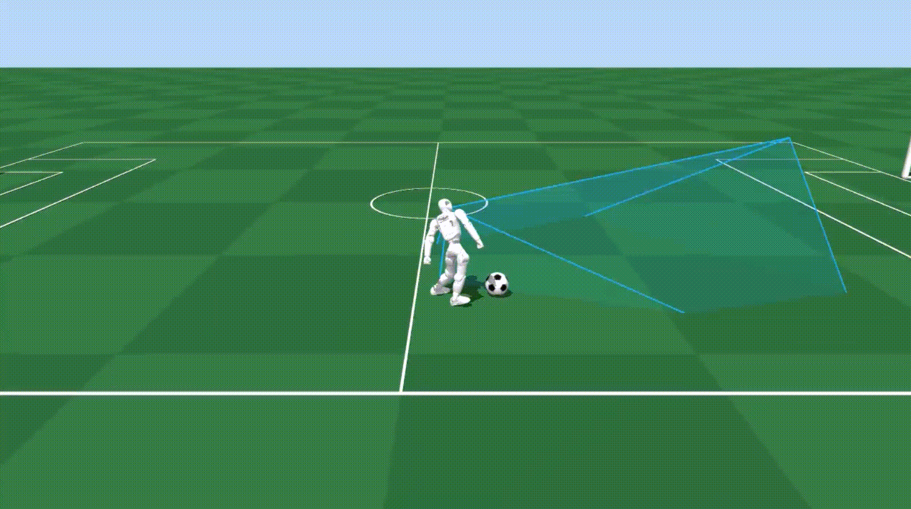

# 足球踢球

[English](README.md) | 简体中文

本课程提供基于视觉观测的 Q1 足球策略训练基线，涵盖专家控制器、轨迹数据、模仿学习与在线策略更新，并支持对观测、训练配置和策略进行改进。



## 首次体验

先按[统一环境搭建指南](../../docs/setup.md)完成安装。冒烟训练需要[足球专家 checkpoint](https://drive.google.com/file/d/1Hb_vHlk4TK_Y8A7NvUUSi5kduLvhXu7P/view?usp=sharing)；正式训练还需要完整成功轨迹数据集。这些资产不随 Git 仓库分发。先下载专家权重并保存为 `shared/supermimic/expert/checkpoints/model_17800.pth`，再运行以下冒烟流程。详见[资源准备](#资源准备)。

以下命令从仓库根目录执行。先用教师模型采集 4 个短程训练回合，再启动一次小规模训练：

```bash
python -m expert.collect --bounded-targets --episodes 4 --seed 100008 \
  --threads 1 --checkpoint shared/supermimic/expert/checkpoints/model_17800.pth \
  --output logs/football-kicking-smoke-data
python -m q1_soccer.train --config courses/football-kicking/configs/smoke.json
```

冒烟训练用于确认管线并生成可加载的 checkpoint，不代表策略已经达到可用性能。演示使用最近一次训练的模型：

```bash
python -m q1_soccer.play --checkpoint logs/latest/last.pt --headless --steps 1000
```

## 资源准备

课程正式训练使用登记的完整成功轨迹数据集。教师权重和数据均不纳入 Git：

- 专家权重：`shared/supermimic/expert/checkpoints/model_17800.pth`
- 训练数据：`shared/supermimic/expert/datasets/q1_bounded_v1/`
- 留出验证集：位于上述数据集目录

下载[足球专家 checkpoint](https://drive.google.com/file/d/1Hb_vHlk4TK_Y8A7NvUUSi5kduLvhXu7P/view?usp=sharing)，并保存为 `shared/supermimic/expert/checkpoints/model_17800.pth`；上方采集和训练命令会从该路径加载。完整成功轨迹数据集是单独的资源，若本地缺失，请按 [SuperMimic 专家资源说明](../../shared/supermimic/expert/README.md) 获取。只有专家权重时，可按上方命令采集冒烟数据；采集输出目录必须为空，重跑时请使用新目录并同步修改 `configs/smoke.json` 中的 `dataset` 路径。

## 正式训练与检查

确认正式数据集和教师模型就绪后，从仓库根目录检查配置，再开始训练：

```bash
python -m q1_soccer.train --config courses/football-kicking/configs/soccer.json --check
python -m q1_soccer.train --config courses/football-kicking/configs/soccer.json
```

正式训练使用 CUDA，配置位于 `configs/soccer.json`。冒烟配置使用 CPU，位于 `configs/smoke.json`。输出包含 `best.pt`、`last.pt`、验证指标和运行配置，保存在 `logs/q1-robot-supermimic-<时间戳>/`；`logs/latest/last.pt` 指向最近一次运行。基线记录见 [baseline.json](baseline.json)。

使用训练自带的 wiring、checkpoint 往返及短 rollout 检查进行本地评估：

```bash
python -m q1_soccer.verify --config courses/football-kicking/configs/smoke.json \
  --device cpu --smoke --report logs/football-kicking-evaluation.json
```

默认在线演示可省略 `--headless --steps`。检查演示输出中的 checkpoint 路径和运行步数，便于记录与比较实验。
